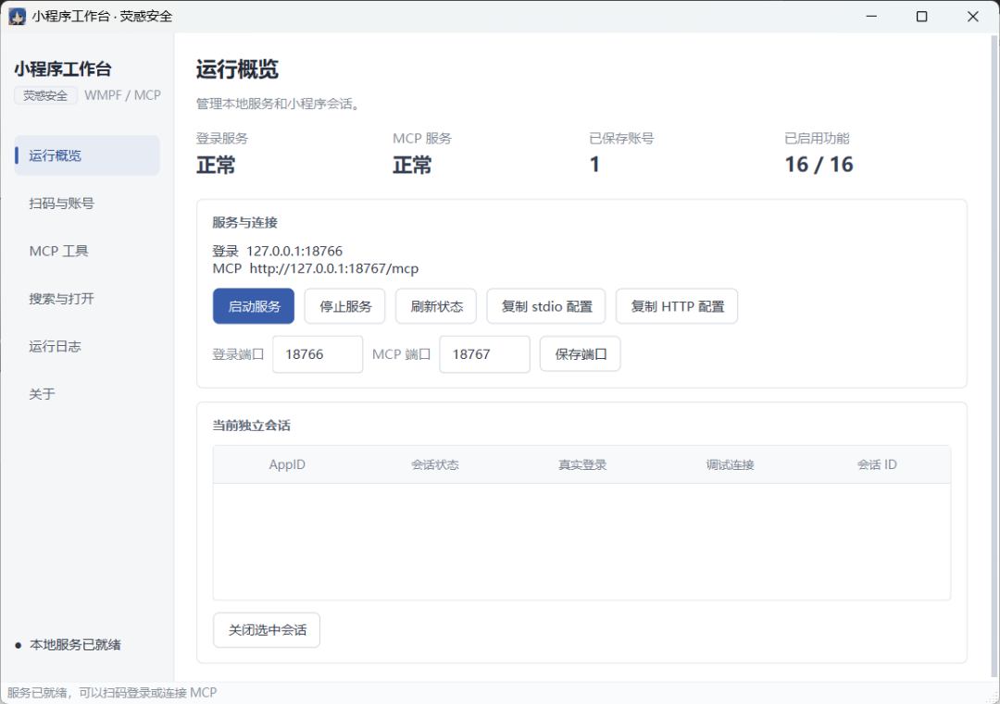
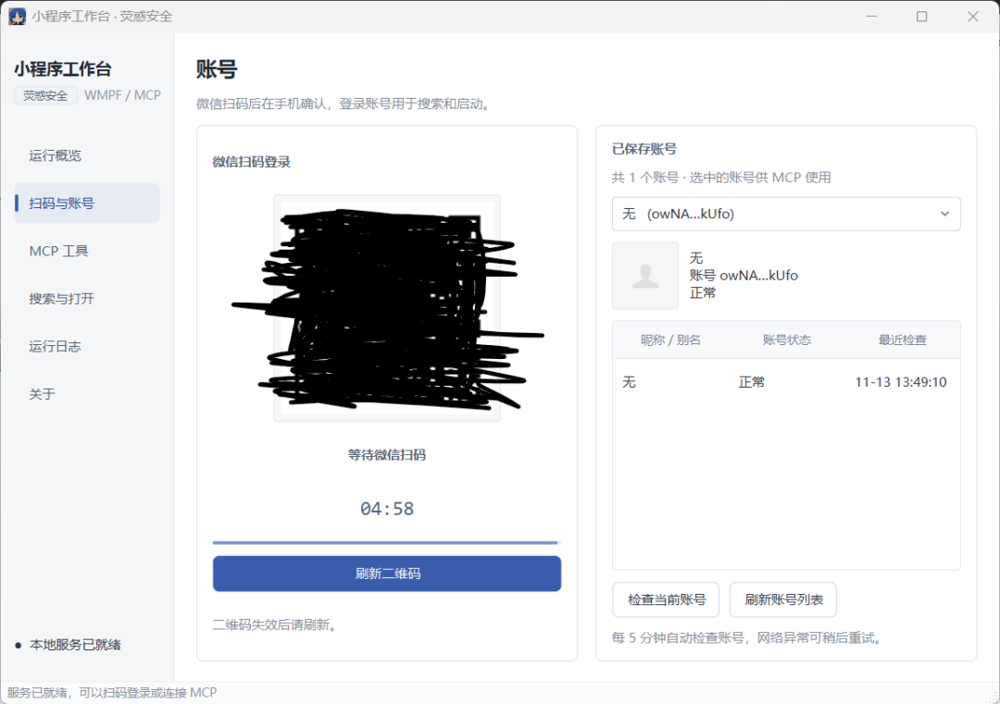
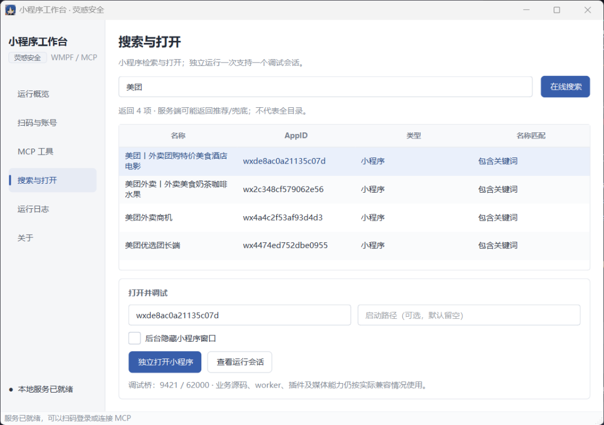
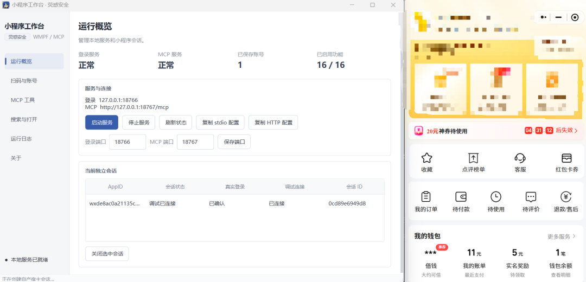
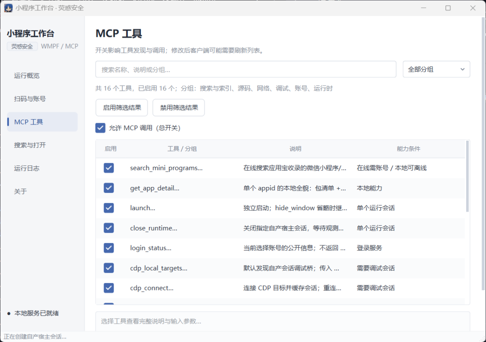
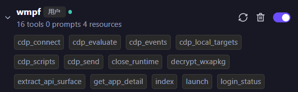
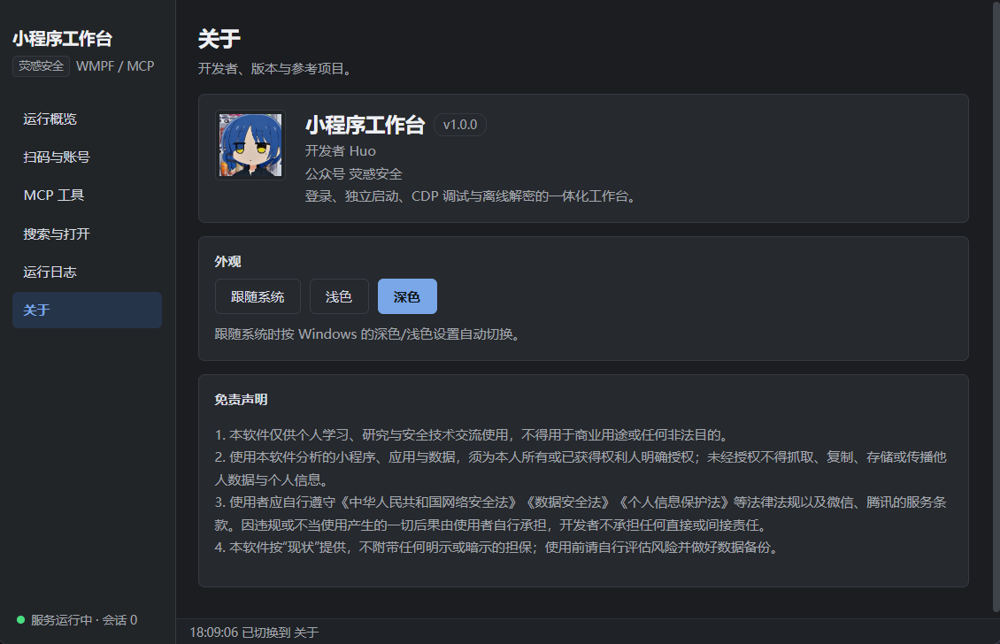

<div align="center">

# 小程序工作台 · WMPFWorkbench-go

**脱离微信独立运行、支持 MCP 的小程序工作台**

<p>
  
  
  
  
</p>

**扫码登录 · 小程序搜索 · 独立启动 · 运行时调试 · 代码还原 · Agent 接入**

> 非官方个人学习与研究作品，与腾讯、微信、应用宝无任何关联。

</div>

---

## 它解决什么问题

做小程序方向的测试，流程往往被切得很碎：找入口用一个工具，调试换一个窗口，想拿代码又得另想办法。

**小程序工作台把这些步骤连起来——从扫码登录到看到代码，中间不需要换程序。** 它把 WMPF 运行时自产宿主化，让小程序脱离微信客户端也能打开和调试，并把全部能力开放成 MCP 接口供 Agent 直接调用。此项目的意义在于提出一个新的方向，为什么小程序逆向时必须要手工在微信中操作？是否可以直接脱离微信？是否可以完全接入agent实现真正的完全自动化？

<div align="center">

| 扫码登录 | 检索 | 独立启动 | 运行时调试 | 代码还原 | Agent 接入 |
|:---:|:---:|:---:|:---:|:---:|:---:|
| 微信扫码<br>账号仅存本机 | 在线 + 本地<br>离线可查 | 自带宿主<br>脱离微信 | 页面/请求/异常<br>可求值 | 加密包离线<br>还原工程 | 16 个工具<br>MCP 开放 |

</div>

---

## ⚠️ 能力边界（务必先读）

<div align="center">

> ### 本项目只面向「应用宝渠道收录」的小程序
>
> **搜索**走的是应用宝在线搜索接口，**启动**前必须经应用宝服务端详情校验并签发启动信封（`f27`）。
>
> 因此：**只有应用宝收录的小程序才能被搜索到并独立启动**。仅存在于微信本地缓存、未被应用宝收录的小程序，会在启动前以 `服务端详情中没有请求的小程序` 被拒绝——即使本机已有它的 `wxapkg` 包也一样。
>
> 这不是 bug，而是协议机制决定的：`f27` 启动信封由应用宝服务端签发，本项目无法自行构造。

</div>

<details>
<summary><b>技术细节：为什么会有这个限制？</b></summary>

`launch` 在拉起宿主之前，会先调用应用宝的 `/pc_yyb_client/pcyyb_get_app_detail` 校验 appid：

- 服务端返回的 `data.apps` 中找不到该 appid → 直接返回 `服务端详情中没有请求的小程序`，**worker 根本不会启动**；
- 校验通过后，再调用 `/v3/pcyyb_encrypt_wx_mini_program_launch_param` 由服务端签发 `f27` 信封（`iv/data/timestamp/authtag`）；
- 本地只做签名请求与 protobuf 封装，不生成也不破解信封内容。

相关代码：`native/internal/launch/inputs.go:144`（详情校验）、`:165`（信封申请）、`:54`（`BuildConfig` 封装）。

</details>

---

## 界面预览

<div align="center">

### 运行概览
服务状态、会话状态与 MCP 配置一键复制



<br><br>

### 扫码与账号
微信扫码登录，账号仅存本机，界面只显示脱敏标识



<br><br>

### 搜索与打开
应用宝在线搜索，选中 AppID 后独立启动并调试（一次一个会话）



<br><br>

### 运行中的小程序
左侧会话状态，右侧为独立启动的小程序窗口



<br><br>

### MCP 工具面板
16 个工具可搜索、分组、逐项或批量开关



<br><br>

### Agent 侧工具列表



<br><br>

### 关于与免责声明



</div>

---

## 快速开始

### 1. 依赖

| 依赖 | 说明 |
|:---|:---|
| Windows 10/11 x64 | 仅支持 Windows |
| **微信桌面端（WMPF 运行时）** | **必需但不在本仓库分发**，详见下方 |
| Go 1.23+ | 构建登录服务与 MCP/GUI |
| Visual Studio 2022 x64 C++ 工具链 | 构建 C++ 宿主与观测 worker（vswhere 自动查找） |
| WebView2 Runtime | GUI 使用，系统通常已自带 |

### 2. 运行时依赖（重要）

<details open>
<summary>本项目的 C++ 宿主依赖微信的 WMPF 运行库（<code>WeChatAppEx.exe</code>、<code>flue.dll</code>、pcsdk 等）。这些 DLL <b>属于微信产品、可能涉及侵权，因此不随本仓库分发</b>。</summary>

- 请从你本机已安装的微信桌面端获取对应运行时（`5.10.7300.414` / flue sdk 2.4.4），或自行配置到项目约定路径。
- 没有该运行时，登录 / 搜索 / 源码还原可用，但 **独立启动与调试无法工作**。
- 仓库 `.gitignore` 已排除 `runtime/`、`data/`、`dist/`、`build/`，这些运行态文件不会被提交。

</details>

### 3. 构建

```powershell
powershell.exe -NoProfile -ExecutionPolicy Bypass -File native\build-release.ps1
```

脚本会先编译 C++ 宿主、Frida worker、wxapkg 工具并拷入 `native/internal/bundle/bin/`（`go:embed` 输入），再产出两个自包含 Go 程序：**桌面 GUI** 与 **MCP 服务**。`bundle/bin` 下的 exe 不入库，由构建脚本生成。

### 4. 使用

1. 运行构建出的 `wmpf-gui.exe`，在「运行概览」确认登录服务、MCP 服务均正常。
2. 在「扫码与账号」生成二维码，用微信扫码并在手机确认；账号保存到本机，每 5 分钟自动检查并按需更新票据。
3. 在「MCP 工具」查看工具列表、参数与启用条件；可搜索、分组、逐项或批量开关。禁用会同时约束发现与调用。
4. 在「搜索与打开」**搜索应用宝收录的小程序**并选中结果独立打开；概览显示启动 / 登录 / 调试状态。可勾选「后台隐藏小程序窗口」，隐藏后仍可通过 CDP 调试。一次支持一个会话，默认最长 30 分钟。
5. 在概览复制 HTTP 或 stdio 配置给 Agent。推荐 HTTP，与 GUI 共用运行会话；stdio 会创建独立进程，共享账号与开关但会话独立。

> 端口：调试桥 `9421` / `62000`，MCP `18767`，登录服务 `18766`。端口占用时先停止服务并在概览更换后重启。

---

## MCP 工具（16 个）

| 分组 | 工具 |
|:---|:---|
| 搜索与索引 | `search_mini_programs` · `get_app_detail` · `index` |
| 账号 | `login_status` |
| 运行时 | `launch` · `close_runtime` · `runtime_status` |
| 调试 | `cdp_connect` · `cdp_evaluate` · `cdp_send` · `cdp_events` · `cdp_local_targets` · `cdp_scripts` |
| 源码 | `decrypt_wxapkg` · `extract_api_surface` |

完整参数说明见 [MCP 工具说明](docs/MCP工具说明.md)。源码有两条路：`decrypt_wxapkg` 离线还原工程目录；或经 `cdp_events` 取 `scriptId` 后用 `cdp_scripts` 分页读取运行时明文。`Page.getFrameTree` 因当前引擎已确认的崩溃问题明确禁用。

---

## 已知限制

- **仅支持应用宝渠道收录的小程序**（搜索与启动均如此），详见上方 [能力边界](#️-能力边界务必先读)。
- `f27` 启动信封由应用宝服务端签发，本项目不含也无法生成服务端密钥。
- 部分小程序的 worker、插件与媒体能力以实际兼容情况为准；还原产物是运行时结果，不等同官方工程。
- 当前运行环境由已初始化环境整理，不能据此宣称全新环境初始化、全天自然到期保活、任意小程序 / AppService / worker / 插件 / 媒体 / 跨版本均通过。

---

## 工程结构

```text
WMPFWorkbench-go/
  native/cmd/workbench-gui      单 exe：桌面 GUI + 内嵌 MCP 服务（stdio / HTTP）
  native/internal/launch        启动输入（f27 信封、登录票据）准备
  native/internal/hostruntime   自产会话生命周期管理
  native/internal/bundle        内嵌 helper（go:embed，不入库）
  native/worker                 C++ Frida 观测 worker 源码
  native/services/login         Go 登录协议 / HTTP / 数据库
  hostcpp/                      C++ 自产宿主源码与构建脚本
  vendor/KillWxapkg/            Ackites/KillWxapkg (MIT) 离线解密源码
  tools/                        启动观测、调试桥与验证脚本
  data/ dist/ build/ out/       运行态与构建产物（.gitignore 排除，不提交）
```

## 开源协议

本项目采用 **Apache-2.0** 授权（见 [LICENSE](LICENSE)、[NOTICE](NOTICE)）：可自由使用、修改、分发（含商业用途），并附带明确的专利授权；要求是保留版权声明、许可文本与 `NOTICE` 归属声明，修改文件需注明变更。

第三方依赖各自遵循其原许可：Frida 为 LGPL-2.1（静态链接，见 [FRIDA_RELINK.md](docs/FRIDA_RELINK.md)），KillWxapkg 为 MIT，其余见 [THIRD_PARTY_NOTICES.md](docs/THIRD_PARTY_NOTICES.md)。下方「免责声明」是使用责任声明，不构成对许可条款的额外限制——两者冲突时以 [LICENSE](LICENSE) 为准。

## 第三方组件与许可

本项目依赖 Wails v2（MIT）、gorilla/websocket（BSD-3）、MCP Go SDK（MIT）、modernc.org/sqlite（BSD-3）、**Frida（LGPL-2.1+，静态链接进观测 worker）**、KillWxapkg（MIT）等。完整清单见 [REFERENCES.md](docs/REFERENCES.md)，许可义务见 [THIRD_PARTY_NOTICES.md](docs/THIRD_PARTY_NOTICES.md)，Frida 的 LGPL 对应源码与可重链接指引见 [FRIDA_RELINK.md](docs/FRIDA_RELINK.md)。分发二进制前请自行核对相应许可义务。

## 隐私

本项目不上传任何账号、票据或日志。运行时的 `data/`（账号库、配置、会话）仅保存在本机且已被 `.gitignore` 排除。界面只显示脱敏后的账号标识，不提供完整 OpenID 复制入口；票据在会话结束时清理，操作日志对账号与 token 做脱敏。

---

**免责声明**

1. 本软件仅供个人学习、研究与安全技术交流使用，不得用于商业用途或任何非法目的。
2. 使用本软件分析的小程序、应用与数据，须为本人所有或已获得权利人明确授权；未经授权不得抓取、复制、存储或传播他人数据与个人信息。
3. 使用本软件应自行遵守《中华人民共和国网络安全法》《数据安全法》《个人信息保护法》等法律法规以及微信、腾讯的服务条款。因违规或不当使用产生的一切后果由使用者自行承担，开发者不承担任何直接或间接责任。
4. 本软件按「现状」提供，不附带任何明示或默示担保；使用前应自行评估风险并做好数据备份。

## 交流与反馈

- **公众号**：荧惑安全（工具更新、技术文章与问题答疑）
- **QQ 群**：1130438692（使用问题、功能建议、交流小程序安全研究）

提问题或功能建议，欢迎在公众号留言或加入 QQ 群。提交 Issue 前建议先查阅 [MCP 工具说明](docs/MCP工具说明.md) 与已知限制。

<div align="center">

<sub>小程序工作台 · 登录、独立启动、CDP 调试与离线解密的一体化工作台</sub>

</div>
